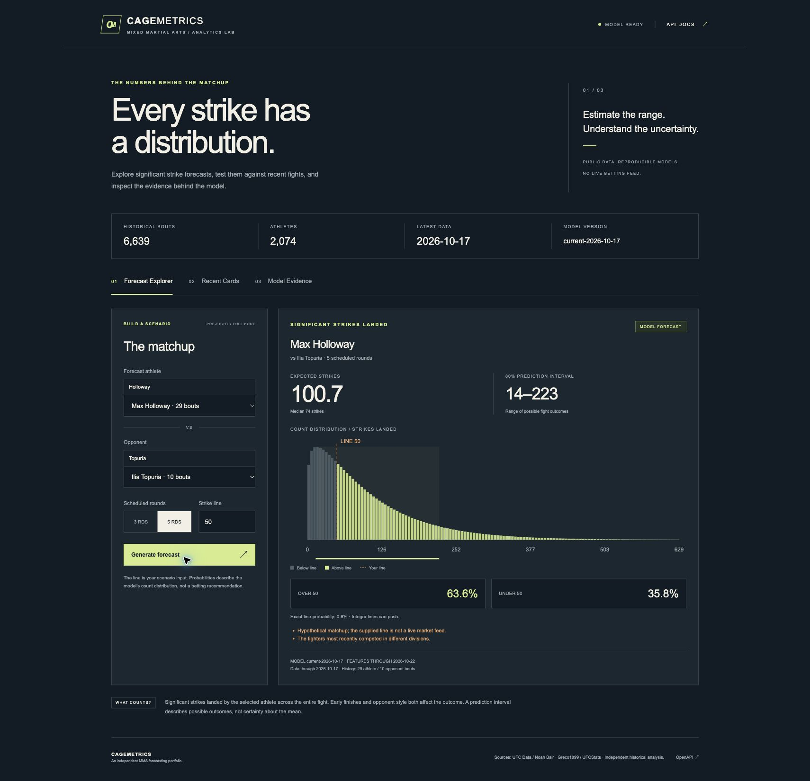

# CageMetrics

**A reproducible UFC significant-strike forecasting system, from pinned source data to SQL-backed FastAPI inference.**

CageMetrics forecasts how many significant strikes one athlete will land against an opponent over a scheduled three- or five-round bout. The dashboard shows the full count distribution, an 80% prediction interval, and over/under/push probabilities for a user-supplied line. Recent fight replays and model evidence sit alongside the forecast explorer.

This portfolio project demonstrates work relevant to a PrizePicks ML engineering internship: point-in-time feature construction, count prediction, probability evaluation, relational data pipelines, API validation, inference lineage, and measured serving performance. It is independent of PrizePicks and UFC. There is no live market feed or profitability claim.



## Run locally

Python 3.12 is the verified runtime. From the project root:

```bash
python3.12 -m venv .venv
source .venv/bin/activate
python -m pip install -c requirements-lock.txt -e '.[dev,postgres]'
cagemetrics demo
cagemetrics serve
```

Open [the dashboard](http://127.0.0.1:8000) or [interactive API documentation](http://127.0.0.1:8000/docs). The demo command migrates SQLite, ingests the pinned dataset, trains the models, and generates evaluation/replay artifacts. Training takes roughly 30 seconds on the development machine; hardware and first-run downloads affect runtime. Server startup loads artifacts and materializes 2,074 athlete feature states in roughly 0.8 seconds on the development machine; it never trains a model. Restart the service after ingestion or training so its cached model and feature states match the new snapshot.

The Git repository tracks processed data, model artifacts, and source manifests. Raw downloads are ignored by Git; the local deliverable/archive includes them. If raw files are missing, the pipeline downloads the pinned source revisions, which requires network access. Rebuilding does not silently replace sources with an unversioned latest dataset. Model artifacts are Python joblib files: load only artifacts from a trusted source.

## What the evaluation shows

The historical report covers **January 1, 2025–October 7, 2026**: 1,870 athlete forecasts from 935 bouts and 76 events. Models use chronological training/calibration periods; the two athlete perspectives of a bout remain in the same temporal partition.

| Model | MAE, strikes | RMSE, strikes | 80% interval coverage |
| --- | ---: | ---: | ---: |
| Gradient boosting, selected | 25.68 | 32.88 | 79.1% |
| Poisson regression | 25.83 | 32.95 | 79.5% |
| Naive historical baseline | 28.24 | 36.52 | 85.8% |

The selected model reduces MAE by **9.06%** against the naive baseline. Its improvement over Poisson regression is small: the event-level paired bootstrap 95% interval for the MAE difference is **−0.49 to +0.15 strikes**, which includes zero. The project does not claim a statistically established improvement over Poisson.

The separate October 8–22 replay contains **25 bouts, 50 athlete outcomes, and two events**, held on October 10 and 17. Its MAE is **20.85**, forecast-minus-actual bias is **+12.74**, and 80% interval coverage is **90.0%**. This small window is a diagnostic, not evidence of durable performance. Recent predictions are reconstructed now using a pre-window artifact and history frozen before October 8; they were not issued before the fights. Strike lines are synthetic training-derived thresholds.

See [MODEL_CARD.md](MODEL_CARD.md), [the complete evaluation](reports/evaluation.json), and [recent predictions](reports/recent_predictions.json) for the split policy, probability diagnostics, subgroup errors, and limitations.

## Architecture and provenance

```text
Pinned raw snapshots → normalize + validate → SQL tables → lagged features
                                                        ↓
                            chronological train / calibrate / evaluate
                                                        ↓
                         versioned artifacts + JSON evaluation reports
                                                        ↓
Browser → FastAPI → two SQL feature-state rows → matchup features → inference
                                                                       ↓
                                                                SQL audit trail
```

The service uses synchronous FastAPI handlers, SQLAlchemy 2, Alembic, NumPy/pandas, scikit-learn, and SciPy. A buildless HTML/CSS/JavaScript dashboard is served by the same process. SQLite is the default fully exercised database. PostgreSQL 17 has passed local migration, real-data ingestion, cutoff queries, and prediction-lineage tests through the same repository. Configure it through `DATABASE_URL`; a local PostgreSQL installation works without Docker. No GPU, queue, or separate frontend service is needed.

SQL tables include `source_snapshots`, `fighters`, `events`, `bouts`, `fighter_bout_stats`, `fighter_feature_states`, `model_versions`, `evaluation_runs`, `feature_snapshots`, and `predictions`. Migration `0002` adds athlete feature states keyed by source snapshot and as-of date. Startup materializes these reusable historical summaries; each forecast reads two athlete-state rows and assembles matchup features instead of merging full fight histories with pandas. Exact-parity tests compare materialized features with the history-based computation. Each inference persists its feature values/hash, artifact/model identity, request inputs, forecast result, and feature cutoff. A prediction ID retrieves the saved response. Source manifests preserve retrieval timestamps, pinned commits, URLs, and SHA256 hashes. Retrieval time and historical event time are distinct: reconstructing lagged statistics does not prove that the entire source snapshot existed before the event.

The dataset contains **6,639 bouts, 13,278 athlete outcomes, and 2,074 fighters**, with completed results through **October 17, 2026**. The historical base is Noah Bair’s UFC Data; a Greco1899 UFCStats increment supplies the most recent event. Read [data attribution and licenses](data/ATTRIBUTION.md) before redistributing data. The CC BY 4.0 historical source and GPL-3.0 repository source have separate attribution/license records. No scraper implementation was copied.

## Reproduce individual stages

```bash
cagemetrics migrate
cagemetrics ingest
cagemetrics features
cagemetrics train
cagemetrics evaluate
cagemetrics infer-recent
```

`train` generates the evaluation and recent artifacts; `evaluate` reads the generated evaluation rather than fitting another model. `infer-recent` reruns the frozen recent artifact. `ingest --refresh` rebuilds processed data from pinned raw files. Configuration uses `CAGEMETRICS_HOME`, `CAGEMETRICS_DATA_DIR`, `CAGEMETRICS_ARTIFACT_DIR`, `CAGEMETRICS_REPORT_DIR`, and `DATABASE_URL`; defaults resolve from the project location.

For an existing local PostgreSQL database:

```bash
export DATABASE_URL='postgresql+psycopg://localhost/cagemetrics'
cagemetrics migrate
cagemetrics ingest
cagemetrics serve
```

Create the database and configure authentication separately. SQLite remains the quickest path to a complete local demo.

## API

| Method and path | Behavior |
| --- | --- |
| `GET /health/live`, `/health/ready` | Process health and initialized model/database status |
| `GET /api/v1/fighters?q=Holloway` | Find stable athlete IDs |
| `GET /api/v1/overview` | Dataset, quality, model, and replay summary |
| `POST /api/v1/predictions` | Persist a hypothetical forecast and its lineage |
| `GET /api/v1/predictions/{prediction_id}` | Retrieve the saved forecast |
| `GET /api/v1/recent` | Frozen-window historical replay |
| `GET /api/v1/evaluation` | Chronological model report |
| `GET /api/v1/models/current` | Current artifact metadata |
| `GET /api/v1/benchmark` | Latest measured benchmark, or an explicit unmeasured state |

Prediction requests require distinct `fighter_id` and `opponent_id`, `scheduled_rounds` equal to 3 or 5, and a finite `line` between 0 and 1,000. Responses include the mean, median, interval, count probabilities, model/data/feature cutoffs, sample-history counts, warnings, and a persisted prediction ID. Integer lines have a separate push probability; half-point lines cannot push. See `/docs` for executable schemas.

## Tests and performance

```bash
pytest
ruff check src tests
```

Tests cover data normalization, leakage and same-day history rules, chronological partitions, distribution arithmetic, SQL ingestion and persistence, migrations, materialized-feature parity, and API behavior. The PostgreSQL-enabled local suite passes 48 tests; the default run passes 47 and skips the optional PostgreSQL check. Keep the model/data artifacts available for integration checks. PostgreSQL integration tests opt in through `CAGEMETRICS_TEST_DATABASE_URL`, which must point to a dedicated test database. The CI workflow installs the constrained dependencies and runs the configured checks.

With the server running in another terminal:

```bash
cagemetrics benchmark --url http://127.0.0.1:8000 --requests 300 --concurrency 1 --warmup 20
cagemetrics benchmark --url http://127.0.0.1:8000 --requests 500 --concurrency 10 --warmup 20
```

The verified Apple M4 / Python 3.12 / single-worker local measurements are:

| Database | Requests | Concurrency | p95 | Errors |
| --- | ---: | ---: | ---: | ---: |
| SQLite | 300 | 1 | 6.5 ms | 0 |
| SQLite | 500 | 10 | 73.3 ms | 0 |
| PostgreSQL 17 | 500 | 10 | 71.4 ms | 0 |

Native CPU thread defaults are set before scientific imports to avoid oversubscribing the ASGI request threads. These measurements use pre-materialized athlete summaries and include SQL prediction persistence. They do not include public-network latency or service startup. The PostgreSQL run is saved separately in `reports/benchmark-postgresql-c10.json`.

Inspect both [concurrency-one](reports/benchmark-c1.json) and [concurrency-ten](reports/benchmark-c10.json) reports. They contain timestamps, environment, latency percentiles, throughput, error counts, and the measured workload. The current workload includes the HTTP request, SQL feature-state lookup, matchup feature assembly, count-distribution inference, and persisted audit trail. Reports from earlier revisions may describe the previous raw-history merge path; regenerate them against the running revision before comparing results. Loopback results exclude service startup/external network latency; individual timings exclude the client semaphore wait. Higher concurrency can expose database write contention and thread scheduling costs, so the single-request benchmark should not be presented as a scaling guarantee. Regenerate reports after runtime changes instead of relying on stale latency claims.

## Screenshots and project map

- [Desktop forecast](reports/forecast-desktop.jpg), [recent replay](reports/recent-desktop.jpg), [model evidence](reports/evidence-desktop.jpg).
- [Mobile forecast](reports/forecast-mobile.jpg), [recent replay](reports/recent-mobile.jpg), [model evidence](reports/evidence-mobile.jpg).
- `src/cagemetrics/`: ingestion, SQL repository, features, modeling, CLI, API, and dashboard.
- `migrations/`: Alembic schema history.
- `data/`: pinned sources, normalized tables, source manifests, SQLite database, attribution.
- `artifacts/`: current and recent model artifacts plus metadata.
- `reports/`: evaluation, replay, benchmark reports, and screenshots.
- `tests/`: data, feature, model, SQL, and API verification.

This is a runnable local project. A public hosting URL is not claimed. `render.yaml` provides deployment configuration but has not been deployed. For serving outside the development machine, configure a Python web host, database persistence, process management, and access controls deliberately.
