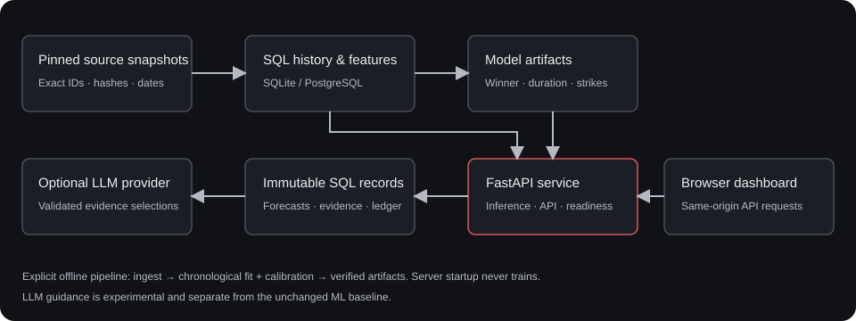

# OctogonML

[](https://github.com/jas0nriverah/OctogonML/actions/workflows/ci.yml)

UFC matchup research with independent winner, elapsed-time, and significant-strike models, a FastAPI dashboard, and an auditable SQL forecast ledger.

**Research only · Not betting advice.** Estimates can be wrong. Do not use OctogonML to place bets or risk money.



## What it does

| Capability | Behavior |
| --- | --- |
| Matchup Lab | Separate win probabilities, duration distributions, and athlete strike forecasts |
| Fighter directory | Search 2,074 covered athletes, inspect observed history, and compare matchups |
| Historical cards and replays | Inspect pinned announcements, projections, and reconstructed outcomes |
| Forecast ledger | Preserve pre-event issuance, model identity, source hashes, and date cutoffs |
| Grounded analysis | Optional Ollama/OpenAI narration from saved evidence; experimental guidance stays separate |
| Local API | One Python service, static UI, SQLite by default, optional PostgreSQL |

The packaged history contains **6,639 bouts through October 17, 2026**. Schedule/ranking observations and screenshots are dated historical snapshots, including the October 22 card observation; they are not refreshed automatically. Documentation reviewed November 12, 2026.

## Start locally

Use Python **3.12** for the packaged artifacts. The application is OctogonML; its Python package and CLI are `cagemetrics`.

```bash
git clone https://github.com/jas0nriverah/OctogonML.git
cd OctogonML
python3.12 -m venv .venv
.venv/bin/python -m pip install -r requirements-lock.txt -e '.[dev]'
./start.sh
```

Open [the dashboard](http://127.0.0.1:8000) or [API schemas](http://127.0.0.1:8000/docs). Bootstrap uses packaged data and models; it does not train a model. No LLM or API key is required for the forecasts.

For PostgreSQL, `docker compose up --build` starts the API and a local database with persistent volumes. The Compose port is bound to loopback. Configuration examples are in [.env.example](.env.example); that file is not automatically loaded by the native service.

## Model policy

The default winner is **V2**, strike inference uses **V3**, and elapsed duration has an independent model. Winner V3/V4 candidates failed their replacement gates and remain research channels. Retained 2024 comparisons were previously inspected, not untouched holdouts. The experimental LLM overlay has no established predictive or calibration gain.

Read [model evidence](docs/model-evidence.md) for the preserved metrics, source dates, failed studies, and method caveats. [Data attribution](data/ATTRIBUTION.md) records source licenses and provenance.

## Documentation

| Task | Guide |
| --- | --- |
| Understand the service and data flow | [Architecture](docs/architecture.md) |
| Set up, test, and change code | [Development](docs/development.md) |
| Start, diagnose, back up, upgrade, or roll back | [Operations](docs/operations.md) |
| Measure API performance | [Benchmarking](docs/benchmarking.md) |
| Inspect historical model results | [Model evidence](docs/model-evidence.md) · [Model card](MODEL_CARD.md) |
| Follow pre-event issuance and settlement | [Forecast workflow](docs/FORWARD_GUIDE.md) |
| Configure optional local or OpenAI analysis | [Provider setup](docs/LOCAL_LLM.md) |
| Review detailed design and failed winner studies | [Engineering decisions](docs/ENGINEERING.md) · [Winner research](docs/WINNER_RESEARCH.md) |
| Contribute or report a vulnerability | [Contributing](CONTRIBUTING.md) · [Security](SECURITY.md) |

## Scope

Covered UFC history since 2013 is not a complete MMA record. Raw comparison rates are not opponent-adjusted model estimates. Completing scheduled time is not necessarily a decision. Published strike thresholds are synthetic, not live market lines.

Sparse-history versus established top-five comparisons can withhold a published favorite while retaining the numerical research output. This operational publication policy does not change the model probabilities or provide a calibrated confidence score.

The repository includes local and container workflows. It does not claim a publicly deployed service, cloud production validation, or an externally audited security posture.

Application code is [MIT licensed](LICENSE). Data, model weights, and referenced media retain their respective licenses and ownership. [Dashboard screenshot](reports/upcoming-desktop.jpg) · [Matchup screenshot](reports/forecast-desktop.jpg).
