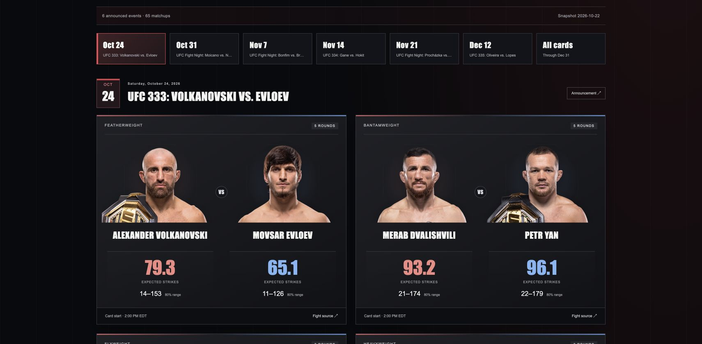

# OctogonML

[](https://github.com/jas0nriverah/OctogonML/actions/workflows/ci.yml)

UFC matchup analysis built with FastAPI, SQLAlchemy, and scikit-learn. Three independent models estimate **who wins a decisive fight**, **elapsed fight time**, and **each athlete's significant strikes**. An optional local LLM explains saved forecasts and proposes a separately labeled, experimental probability adjustment.

The dashboard combines announced cards, fighter profiles, observed comparisons, probability charts, and a prospective forecast ledger. Every saved forecast retains its model, source snapshot, feature values, and date cutoffs.

**Research only — not betting advice.** Estimates can be wrong. Do not use OctogonML to place bets or risk money.



## Run locally

Requires Python 3.12. The package and CLI are named `cagemetrics`.

```bash
git clone https://github.com/jas0nriverah/OctogonML.git
cd OctogonML
python3.12 -m venv .venv
source .venv/bin/activate
pip install -c requirements-lock.txt -e '.[dev,postgres]'
cagemetrics bootstrap
cagemetrics serve
```

Open [the dashboard](http://127.0.0.1:8000). Interactive API schemas remain available at [the `/docs` URL](http://127.0.0.1:8000/docs). Bootstrap migrates SQLite and imports the included normalized data; it neither downloads sources nor refits packaged models. Verified photos load from ESPN/UFC hosts, with initials when unavailable.

Environment variables configure paths, database, model channels, and optional LLM providers; see [.env.example](.env.example). Set them in the service environment; copying this file alone does not configure the running process. Restart after replacing a model or importing a new source snapshot.

For PostgreSQL, set `DATABASE_URL` before bootstrap. Alternatively, `docker compose up --build` starts the API and PostgreSQL with persistent volumes. The checked-in [Compose configuration](compose.yaml) and native service both use the `auto` strike channel. Local LLM weights are not included in the image or repository.

### Optional local AI

Install [Ollama](https://ollama.com/download), start its local service, then run:

```bash
ollama pull qwen3:4b
export CAGEMETRICS_LLM_PROVIDER=ollama
export CAGEMETRICS_LLM_MODEL=qwen3:4b
export OLLAMA_URL=http://127.0.0.1:11434
cagemetrics serve
```

No API key is needed for local Ollama. [Local setup notes](docs/LOCAL_LLM.md) explain the prepared workspace runtime, model license, structured output checks, and optional server-side OpenAI configuration. A clone does not contain model weights. A basic JSON check and complete local analyses in both fighter orientations passed. The complete checks took approximately 38 and 57 seconds; both proposed zero adjustment. These verify the checked workflows, not predictive accuracy or universal semantic reliability. Provider or grounding failures return an explicit unavailable/error state.

### Optional OpenAI analysis

Create a private server-side key file from the project directory:

```bash
cagemetrics setup-openai
```

Open the reported `.secrets/openai_api_key` file in your editor and save **only the key text**, without quotes or `OPENAI_API_KEY=`. Keep the key out of chat, browser code, and Git. The command creates a new file with mode `0600` and preserves an existing file. `.secrets/` is excluded from Git, Docker build context, and the source archive.

Then start the service explicitly with OpenAI:

```bash
cagemetrics serve --llm-provider openai
```

This selects [`gpt-6.1-sol`](https://developers.openai.com/api/docs/models/gpt-6.1-sol) by default; an explicit `OPENAI_MODEL` environment value overrides it. Credentials resolve from `OPENAI_API_KEY`, then `OPENAI_API_KEY_FILE`, then the project's private key file. An explicitly configured missing key file is an error. Ollama remains the default unless you switch providers; saving a key alone never enables paid requests. Restart after configuration changes.

The OpenAI adapter uses the Responses API; account/model access and API billing apply separately. A live OpenAI request has not yet been verified for this setup. Provider configuration alone does not establish better predictions or explanations. See [provider setup and request bounds](docs/LOCAL_LLM.md).

## Data and interface

The pinned completed-fight snapshot contains **6,639 bouts, 13,278 athlete-bout observations, and 2,074 fighters**, spanning February 2013–October 17, 2026. It combines Noah Bair's UFC Data with an exact-ID UFCStats increment from Greco1899. [Attribution](data/ATTRIBUTION.md) documents licenses, commits, hashes, retrieval times, and transformations. Raw source downloads are Git-ignored; the prepared project archive retains them. An explicit ingestion command can recover the pinned sources for a clone.

The October 22 schedule observation covers six announced events and 65 bouts through December 31. It produces **118 athlete projections for 59 matched bouts**; six unresolved bouts remain visible without forecasts. Times are published card/segment starts, not individual walkout times. Bookings can change.

- [Upcoming projections](reports/upcoming_predictions.csv) and [complete forecast payloads](reports/upcoming_predictions.json)
- [Preserved V2 issuance](reports/issued_forecasts.json) and [separate V3 issuance](reports/issued_forecasts_v3.json)

Issued pre-event forecasts and reconstructed historical predictions are different evidence. Preserved forward batches have no settled outcomes yet; a new database begins with its own empty ledger. Reported strike thresholds are synthetic, with no live market feed.

**Matchup Lab** presents winner, duration, and strike models separately. Observed comparisons cover striking output, absorbed strikes, net differential, accuracy, defense, duration, and sample sizes for last-five/all-covered windows. Rates use ratio-of-sums aggregation. Covered UFC history since 2013 is not a complete MMA career record. More projected strikes do not determine who wins; completing scheduled time does not prove the bout ends in a decision.

Hypothetical scenarios require known last covered UFC divisions within the same competition category, separated by at most one class. Wider gaps are marked **Unrealistic matchup**; unknown classes remain unavailable. This is an application policy, not official matchmaking eligibility. Division ceilings are not measured body weights.

**Fighters** provides searchable, division-filtered profiles for all 2,074 canonical athletes. **2,036 have verified portraits**: 1,844 ESPN and 192 UFC. The other 38 use initials: 36 lack a qualifying verified portrait and two have ambiguous identities. A filename identity audit removed 96 unverified, opponent, or placeholder assets. [Photo coverage](data/fighter_profiles/ufc_coverage.json) and the [asset audit](data/fighter_profiles/ufc_image_identity_audit.json) retain the evidence; no images are generated or rehosted.

A separate [official UFC rankings observation](data/rankings/current.json) contains 206 mapped entries across 13 boards. Its page provides no explicit weekly board date, so the project records observation time and leaves `published_board_date` null. Display observations never backfill historical model inputs. Missing or stale dated ranking evidence means **unknown**, not unranked.

## Model evidence

All results below are retrospective. Candidate selection uses declared development periods; 2024 was previously inspected in this project and is not an untouched holdout. Prospective performance remains pending.

### Decisive winner

The gated **99-feature Winner V2** uses lagged striking, grappling, control, prior-result strength/form, age, physical measurements, division contrasts, and dated ranking evidence. It is separate from the strike and duration estimators. Training/calibration exclude draws; opposite fighter perspectives produce complementary probabilities.

| 2024 comparison · 507 decisive bouts | Accuracy | Log loss ↓ | Brier ↓ |
| --- | ---: | ---: | ---: |
| Preserved 46-feature winner baseline | 57.79% | 0.674632 | 0.240965 |
| Winner V2 | **63.91%** | **0.642838** | **0.225529** |

V2 was chosen from four fixed candidates using **2021–2023 only**, not the 2024 results. Development log loss improves from 0.674881 to 0.653719. Its paired event-bootstrap difference is −0.021162, with a 95% interval of [−0.030922, −0.011478] across 128 events. The stored promotion gates also check Brier nonregression, calibration stability, and annual consistency. These checks do not establish future accuracy or justify an extreme probability for an individual matchup.

See [Winner V2 evaluation](reports/winner_v2_evaluation.json), [selection](reports/winner_v2_selection.json), [prediction rows](reports/winner_v2_predictions.csv), and [metadata](artifacts/winner_v2/metadata.json). The default independent winner channel is `auto`, with `CAGEMETRICS_WINNER_CHANNEL=v1` for rollback.

### Elapsed rounds

The independent duration model estimates a distribution over 20 time categories: half-round interiors plus exact boundary atoms through five rounds, with unsupported categories masked in three-round scenarios. Over/under/push probabilities preserve exact boundary mass; interior seconds follow an explicit uniform assumption.

| 2024 comparison · 507 bouts | Scheduled empirical baseline | Duration HGB |
| --- | ---: | ---: |
| Category log loss ↓ | 1.544579 | **1.534827** |
| Survival Brier ↓ | 0.188263 | **0.180496** |
| Completion Brier ↓ | 0.250764 | **0.238192** |

Nominal 80% duration intervals cover 93.7% of these outcomes: conservative coverage, not evidence of calibrated 80% intervals. See [duration evaluation](reports/rounds_evaluation.json) and [row-level predictions](reports/rounds_predictions.csv).

### Significant strikes

The V3 strike channel uses 33 pre-fight inputs and a duration-conditioned negative-binomial mixture. A symmetric gate weights full-duration and early-stop conditional count models; realized duration is a training label, never an inference input.

Development NLL improves from 4.75050 to 4.72267 on 2021–2023. The separately reported, previously seen 2024 comparison improves from 4.78220 to 4.73010; its paired event-bootstrap NLL difference is −0.05210 (95% interval −0.06948 to −0.03475). **No mean-count MAE improvement is established.**

The preserved V1 historical report covers 1,870 athlete forecasts during January 2025–October 7, 2026: boosting MAE **25.68** versus **28.24** for the last-five baseline. These are metrics for that historical evaluation, not a new test of the current V3 artifact. The October 8–22 replay has 50 outcomes, MAE 20.85, and +12.74 forecast-minus-actual bias; it was reconstructed after the events.

See the [model card](MODEL_CARD.md), [V1 report](reports/evaluation.json), [V2 feature study](reports/experiments.json), [V3 study](reports/research.json), and [recent replay](reports/recent_predictions.json).

### Experimental AI guidance

The narrator receives server-authored evidence tied to saved forecast IDs. It selects sourced advantages, an exact comparison, and a supported conditional route from an evidence-linked catalogue; missing support permits explicit abstention. Rationale and the bounded adjustment proposal remain LLM output. It can propose **at most ±5 percentage points** to the winner probability, with complementary probabilities displayed separately from the unchanged ML baseline. This bound is a policy, not a learned ensemble weight. The adjustment has **no established backtest or calibration performance**; the 63.91% figure above evaluates ML alone.

Analyses retain all server evidence, the IDs of the bounded subset used by the narrator, cited claims, provider/model identity, prompt version, original prediction IDs, and experimental guidance in immutable SQL records. Repeated identical requests reuse the saved result. Client-supplied facts and mismatched athlete, round, date, or source snapshots are rejected.

The [latest local example](reports/matchup-analysis-local-enriched.json) retains 63 server facts and the 24 used by the narrator, including both athletes' frozen strength summaries and latest results. Its live HTTP check took 61.5 seconds, proposed zero adjustment, and passed immutable GET/retry checks. This is a workflow observation, not a capacity benchmark. The [earlier example](reports/matchup-analysis-example.json), [desktop analysis](reports/matchup-analysis-desktop.jpg), and [mobile analysis](reports/comparison-mobile.jpg) retain the previous prompt's response and layout.

## Architecture and reproducibility

```text
Pinned sources → validated SQL history → strictly prior-event features
                                           ↓
                         chronological fit → reserved calibration
                                           ↓
                      versioned artifacts → FastAPI → dashboard
                                               ↓
                         immutable forecasts, evidence and analyses
```

SQLAlchemy supports SQLite and PostgreSQL; Alembic manages schema versions. Prepared athlete states reduce request-time history work. Source/artifact mismatches fail explicitly; startup never fits models. Exact-date/identity settlement preserves issued forecasts. Read [engineering decisions](docs/ENGINEERING.md) and the [forward workflow](docs/FORWARD_GUIDE.md).

```bash
cagemetrics ingest --refresh
cagemetrics features
cagemetrics train
cagemetrics experiment
cagemetrics research
cagemetrics train-winner
cagemetrics train-winner-v2
cagemetrics train-rounds
cagemetrics infer-recent
cagemetrics refresh-schedule --through 2026-12-31
cagemetrics project-upcoming
```

These are explicit pipeline stages, not prerequisites for serving packaged artifacts. Winner/duration commands reuse existing artifacts only after verification; they do not promise byte-identical refits from serialized joblib files. For an independent refit, use fresh `CAGEMETRICS_ARTIFACT_DIR` and `CAGEMETRICS_REPORT_DIR` paths, retain the baseline prerequisite for Winner V2, and recover the pinned raw sources where required. Source revision changes require an explicit `ingest --increment-sha <40-hex-commit> --refresh`; existing conflicting source records are rejected rather than silently corrected.

`CAGEMETRICS_MODEL_CHANNEL=auto` chooses an available V3 strike artifact, then V2, then V1. Pin `v1`, `v2`, or `v3` for a strike rollback. Winner selection is independently controlled by `CAGEMETRICS_WINNER_CHANNEL=auto|v1|v2`; `auto` promotes only a verified V2 artifact with passing gates. Restart after changes. Previous forecasts are never rewritten, and replaced upcoming reports are archived byte-for-byte.

Photo jobs are independent of modeling: `python scripts/refresh_fighter_photos.py --workers 8` resumes ESPN observations; `--profile-fallback` checks verified profiles, `--ufc-fallback` recovers missing official portraits, and `--audit-ufc-images` quarantines assets without verified filename identities. `--retry-failures` explicitly revisits unresolved queries. `python scripts/refresh_rankings.py` freezes a separate official ranking observation. Serving performs none of these network refreshes.

## API

| Endpoint | Purpose |
| --- | --- |
| `GET /health/live`, `/health/ready` | Process, loaded model, database/source readiness |
| `GET /api/v1/fighter-directory`, `/api/v1/fighters/{id}` | Search and individual observed profiles |
| `GET /api/v1/matchups`, `/api/v1/matchup-eligibility` | Historical comparison and division policy |
| `POST /api/v1/predictions` | Save a significant-strike distribution |
| `POST /api/v1/predict-winner` | Save decisive-outcome probabilities |
| `POST /api/v1/predict-rounds` | Save elapsed-time survival/boundary probabilities |
| `GET /api/v1/predictions/{id}`, `/winner-predictions/{id}`, `/rounds-predictions/{id}` | Retrieve the corresponding forecast family under `/api/v1` |
| `POST /api/v1/matchup-analysis` | Explain matching saved forecasts and save experimental AI guidance |
| `GET /api/v1/matchup-analyses/{id}` | Retrieve an immutable saved analysis |
| `GET /api/v1/rankings`, `/api/v1/fighter-photos` | Sourced display observations |
| `GET /api/v1/upcoming`, `/api/v1/recent` | Announced projections and reconstructed recent results |
| `GET /api/v1/winner-evaluation`, `/api/v1/rounds-evaluation`, `/api/v1/research` | Separate model reports |
| `GET /api/v1/forward`, `POST /api/v1/forward/batches` | Pre-event issuance and later settlement |
| `GET /api/v1/operations`, `/api/v1/release` | Runtime and release metadata |

## Validation and performance

```bash
pytest
ruff check src tests migrations scripts
node --check src/cagemetrics/web/app.js
```

Tests cover temporal isolation, identity/source integrity, training/serving parity, probability atoms, migrations, immutable records, API errors, and mocked LLM failures. PostgreSQL integration uses a dedicated `CAGEMETRICS_TEST_DATABASE_URL`; CI also builds and checks the container.

Controlled V3 **strike endpoint** benchmarks on Apple M4/Python 3.12/one Uvicorn worker use 100 warmup requests and 50 scenarios, with all services ready and no concurrent LLM generation. They include inference and SQL audit writes, excluding startup and external network latency:

| Database | Requests | Concurrency | p95 | Errors |
| --- | ---: | ---: | ---: | ---: |
| SQLite | 300 | 1 | 9.7 ms | 0 |
| SQLite | 500 | 10 | 138.4 ms | 0 |
| PostgreSQL 17 | 500 | 10 | 178.1 ms | 0 |

[Serial](reports/benchmark-mixed-sqlite-c1.json), [SQLite concurrent](reports/benchmark-mixed-sqlite-c10.json), and [PostgreSQL concurrent](reports/benchmark-mixed-postgresql-c10.json) reports retain workload/version details. They do not measure the winner, duration, or LLM endpoints. Regenerate for a changed environment with `cagemetrics benchmark --requests 500 --concurrency 10 --warmup 100 --workload mixed`.

## Documentation

[Model card](MODEL_CARD.md) · [Engineering](docs/ENGINEERING.md) · [Forecast workflow](docs/FORWARD_GUIDE.md) · [Smoke checks](docs/SMOKE_TEST.md) · [Local AI setup](docs/LOCAL_LLM.md) · [Attribution](data/ATTRIBUTION.md)

[Directory screenshot](reports/fighter-directory-desktop.jpg) · [Profile](reports/fighter-profile-desktop.jpg) · [Mobile](reports/fighter-profile-mobile.jpg) · [Matchup dashboard](reports/forecast-desktop.jpg)

Application code is [MIT licensed](LICENSE). Data, model weights, and referenced media retain their respective licenses and ownership.
