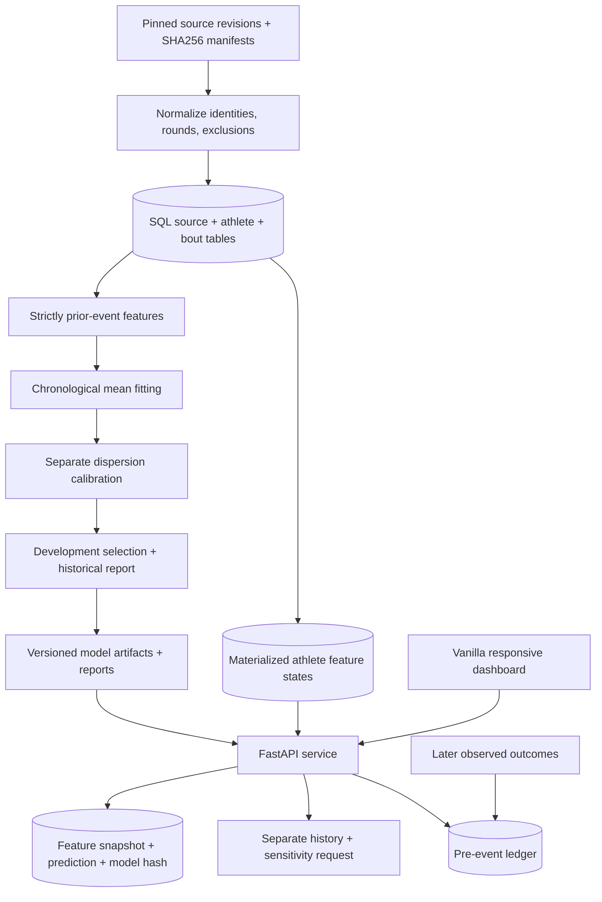

# Engineering decisions

## A complete path from data to an auditable response

The application is one Python service. A static dashboard shares its origin, eliminating a separate frontend deployment and CORS configuration. Synchronous endpoints fit the SQLAlchemy/scikit-learn workload. Native numerical thread limits prevent each HTTP worker from creating an oversized numerical thread pool.

## Database choice and serving cost

SQLite supplies a zero-account local path with real relational constraints and persisted provenance. PostgreSQL 17 exercises the same repository against a server database. Alembic records schema evolution, including materialized athlete states. The PostgreSQL test target must be a dedicated test database, selected by `CAGEMETRICS_TEST_DATABASE_URL`.

The first serving implementation retrieved fight history and performed pandas merges per forecast. Startup now prepares snapshot/as-of-keyed historical summaries. The V1 path reads two SQL state rows and assembles matchup features. V2 uses its prepared historical-state engine with a bounded 512-entry matchup-frame cache; the API still reads two SQL rows for metadata. Both paths predict and persist the full audit record without rebuilding full history merges per request. Exact-parity tests guard the optimization. Rich historical context is a separate on-demand endpoint, keeping it out of the inference benchmark. Restart after ingestion or artifact changes to refresh loaded state.

An ORM and feature table are useful here because they make lineage and invalidation explicit. A distributed feature store, message queue, model-registry service, and GPU cluster would add operational costs without solving a demonstrated workload requirement. This project does not claim distributed production readiness.

## Time semantics and model selection

Feature eligibility uses strictly earlier completed events. Same-day events do not become inputs for one another. Raw snapshot retrieval timestamps remain distinct from event dates; reconstructing a historical statistic cannot prove contemporaneous availability of a later-collected dataset.

Development folds select the model family before the reporting period. Mean fitting and count-dispersion calibration are separate temporal stages. The legacy current artifact’s full-data refit reused a dispersion estimate; the V2 experiment creates a disjoint mean/calibration pairing. Neither construction has untouched future coverage evidence merely because it can be serialized and served. The model card and generated metadata distinguish these artifacts.

The richer candidate adds historical context, recency/shrinkage, and interaction features under an explicit experiment protocol. It is not promoted when the declared development objective does not improve. Later inspected outcomes are labeled retrospective, and a genuine new test belongs in the forward ledger.

## Forward evidence and failure behavior

A retrospective prediction can be regenerated after observing an outcome. A forward entry must instead be recorded before its verified scheduled event and freeze the model, inputs, line kind/source, and creation time. An idempotency key supports safe retry; a result is attached later without rewriting the forecast. Empty forward results are a truthful state. Fixture uncertainty and clock validation belong in the backend, not just in a browser date picker.

Migration `0003` stores this lifecycle in `forecast_batches` and `forecast_entries`. Full CSV and structured JSON exports preserve feature/prediction payloads and lineage. A source-hash guard returns 503 when ingestion changes the snapshot underneath a loaded service; restarting prepares matching state. Inference requires its history cutoff to be later than the latest loaded completed-bout date, preventing use of a partial same-day dataset as if it were complete pre-event history.

The UI shows loading, unavailable-report, empty-ledger, sparse-history, stale-data, and invalid-request states. It never substitutes a plausible chart for missing data. User-supplied JSON is parsed locally before submission, then independently validated by the API. Matchup sensitivity is labeled noncausal and is requested only when the user opens its disclosure.

## Reproducibility and performance evidence

The constrained dependency file, deterministic seeds, source revision/hashes, model metadata, immutable model IDs, SQL feature snapshots, and saved reports make the result inspectable. Joblib artifacts are trusted local inputs; this is not an arbitrary uploaded-model execution service.

Measure both serial and concurrent workloads and retain every relevant report. The benchmark includes HTTP, SQL state lookup, feature assembly, inference, distribution generation, and persisted audit history. Loopback measurements exclude external networking and service startup; per-request timing excludes the client semaphore wait. Report throughput and error rate alongside p50/p95, database engine, workload, and hardware. A fast serial request is not a capacity claim.

The GitHub Actions configuration defines repeatable lint/tests with PostgreSQL. The Render manifest defines a deployment path. Inspect a real CI run or deployment result before claiming either has executed externally.
