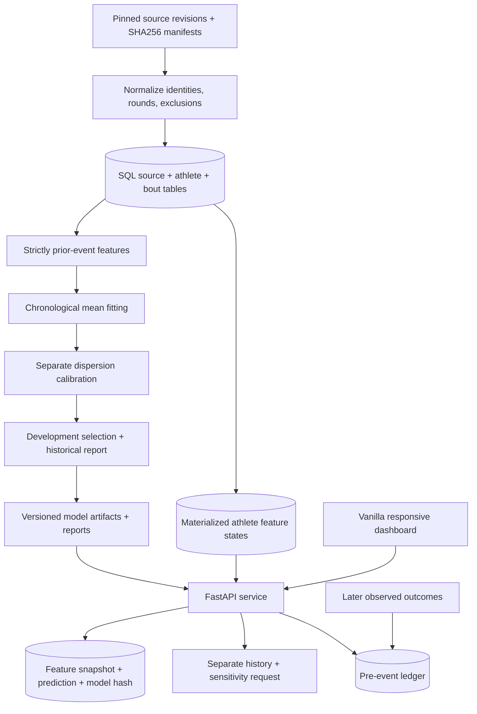

# Engineering decisions

## A complete path from data to an auditable response

The application is one Python service. A static dashboard shares its origin, eliminating a separate frontend deployment and CORS configuration. Synchronous endpoints fit the SQLAlchemy/scikit-learn workload. Native numerical thread limits prevent each HTTP worker from creating an oversized numerical thread pool.

## Database choice and serving cost

SQLite supplies a zero-account local path with real relational constraints and persisted provenance. PostgreSQL 17 exercises the same repository against a server database. Alembic records schema evolution, including materialized athlete states. The PostgreSQL test target must be a dedicated test database, selected by `CAGEMETRICS_TEST_DATABASE_URL`.

The first serving implementation retrieved fight history and performed pandas merges per forecast. Startup now prepares snapshot/as-of-keyed historical summaries. The V1 path reads two SQL state rows and assembles matchup features. V2 and V3 use prepared historical state and a bounded matchup-frame cache; the API still reads two SQL rows for metadata. Each channel predicts and persists the full audit record without rebuilding full history merges per request. Exact-parity tests guard the optimization. Rich historical context is a separate on-demand endpoint, keeping it out of the inference benchmark. Restart after ingestion or artifact changes to refresh loaded state. `CAGEMETRICS_MODEL_CHANNEL` accepts `auto`, `v1`, `v2`, and `v3`; auto prefers an available V3 artifact, then V2, then V1.

The ORM and feature table make lineage and invalidation explicit. The service fits within one process and a relational database; model artifacts and source snapshots are versioned alongside the application.

## Time semantics and model selection

Feature eligibility uses strictly earlier completed events. Same-day events do not become inputs for one another. Raw snapshot retrieval timestamps remain distinct from event dates; reconstructing a historical statistic cannot prove contemporaneous availability of a later-collected dataset.

Development folds select the model family before the reporting period. Mean fitting and count-dispersion calibration are separate temporal stages. The legacy current artifact’s full-data refit reused a dispersion estimate; the V2 experiment creates a disjoint mean/calibration pairing. Neither construction has untouched future coverage evidence merely because it can be serialized and served. The model card and generated metadata distinguish these artifacts.

The richer candidate adds historical context, recency/shrinkage, and interaction features under an explicit experiment protocol. It is not promoted when the declared development objective does not improve. Later inspected outcomes are labeled retrospective, and a genuine new test belongs in the forward ledger.

The separate V3 `research` pipeline keeps the 33 pre-fight inputs and compares eight bounded candidates on 2021–2023 annual folds. Each fold fits means before July of the preceding year and calibrates on the following July–December period. Candidate identity is frozen before the 2024 confirmation comparison. This year was already inspected during earlier work, so it is not an untouched holdout. Already-seen 2025–2026 diagnostics never select the candidate or decide promotion.

V3 uses a full-scheduled-duration versus early-stop auxiliary label only during fitting. Two conditional gradient-boosted means and separately calibrated negative-binomial dispersions form a genuine mixture. The gate averages its predictions under both athlete perspectives, giving the pair a shared symmetric regime probability. Inference receives only pre-fight features; it does not know realized duration. Mixture PMF/CDF, probabilities, and quantiles are evaluated directly rather than replacing the mixture with a single moment-matched distribution. The shared gate does not make the two athlete count distributions a joint outcome model.

Promotion requires at least 0.005 lower development NLL, no more than 1% higher MAE, and lower confirmation NLL with the same MAE tolerance. The saved report and compressed row-level predictions are exposed at `/api/v1/research` and `/api/v1/research/predictions.csv.gz`. Historical NLL improvement is evidence about distribution quality, not established MAE improvement or future performance. Event-bootstrap intervals condition on the fitted models and omit training/selection uncertainty.

## Forward evidence and failure behavior

A retrospective prediction can be regenerated after observing an outcome. A forward entry must instead be recorded before its verified scheduled event and freeze the model, inputs, line kind/source, and creation time. An idempotency key supports safe retry; a result is attached later without rewriting the forecast. Empty forward results are a truthful state. Fixture uncertainty and clock validation belong in the backend, not just in a browser date picker.

Migration `0003` stores this lifecycle in `forecast_batches` and `forecast_entries`. Migration `0004` backfills registered model identity onto each entry and scopes fixture/athlete uniqueness by model version. This permits prospective comparisons while preserving every earlier prediction and recording time. Downgrade refuses to discard distinct versions that would collide. Full CSV and structured JSON exports preserve feature/prediction payloads and lineage. A source-hash guard returns 503 when ingestion changes the snapshot underneath a loaded service; restarting prepares matching state. Inference requires its history cutoff to be later than the latest loaded completed-bout date, preventing use of a partial same-day dataset as if it were complete pre-event history.

New payloads retain serialized distribution parameters, enabling exact NLL on later outcomes beyond the rendered PMF. Legacy entries with missing parameters remain unscored for NLL. Per-model metrics, explicit scored-subset counts, and separately flagged infinite losses avoid pooling incompatible evidence or dropping hard outcomes.

The original 118 issued V2 forecasts remain immutable. A V3 issuance is a separate versioned batch, not an update to those forecasts. Before regenerating the upcoming projection report, preserve its exact prior bytes in a gzip archive under `reports/upcoming_archive/`. This preserves the distinction between a replaceable display report and the append-only issuance ledger.

The UI shows loading, unavailable-report, empty-ledger, sparse-history, stale-data, and invalid-request states. It never substitutes a plausible chart for missing data. User-supplied JSON is parsed locally before submission, then independently validated by the API. Matchup history and sensitivity are fetched separately from the forecast endpoint; sensitivity remains labeled noncausal inside its disclosure.

The fighter catalog uses the same frozen SQL-loaded snapshot. Directory requests paginate stable name/ID ordering and filter by the most recently covered division. Individual profiles reuse the observed matchup-stat aggregation, with strict date cutoffs and ratio-of-sums rates. No full MMA record or unverified physical attributes are inferred. `/fighters/{id}` deep links serve the application shell; the profile API returns 404 for unknown canonical IDs. A bounded file-version cache exposes compact sourced portrait metadata without returning the duplicate raw search manifest to the browser. Network portrait refresh is an explicit script, never a serving or startup operation.

## Reproducibility and performance evidence

The constrained dependency file, deterministic seeds, source revision/hashes, model metadata, immutable model IDs, SQL feature snapshots, and saved reports make the result inspectable. Joblib artifacts are trusted local inputs; this is not an arbitrary uploaded-model execution service.

Measure both serial and concurrent workloads and retain every relevant report. The benchmark includes HTTP, SQL state lookup, feature assembly, inference, distribution generation, and persisted audit history. Loopback measurements exclude external networking and service startup; per-request timing excludes the client semaphore wait. Report throughput and error rate alongside p50/p95, database engine, workload, and hardware. A fast serial request is not a capacity claim.

The [CI workflow](../.github/workflows/ci.yml) runs unit and API tests with PostgreSQL, then builds the Docker image and verifies model readiness in a separate job. Docker Compose provides persistent PostgreSQL and application volumes. The Render manifest supplies an alternative hosting configuration.
