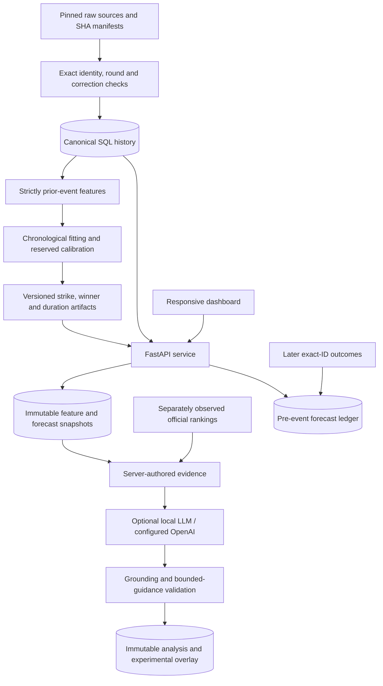

# Engineering decisions

## Service boundaries

One Python service serves the static dashboard and API from the same origin. SQLAlchemy supports SQLite and PostgreSQL; Alembic manages schema changes. Synchronous handlers fit the SQL/CPU inference workload. Native numerical thread limits avoid creating excessive nested numerical pools.

Requests never scrape, download weights, train models, or refresh source observations. Network jobs are explicit scripts/CLI stages. Local LLM generation is a separate, bounded optional request and does not block basic forecast availability when its provider is unavailable.

## Canonical history and source integrity

The normalized snapshot uses stable UFCStats bout and fighter identifiers. Each retained bout has exactly two athlete-stat records. Source round aggregation and labels are validated before SQL import. No-contest, overturned, and unsupported-format exclusions remain explicit. Incremental source revisions are operator-selected 40-hex commits; raw files are cached under owner/commit/file paths and checked against manifest hashes. Legacy cache migration requires the recorded commit and bytes to agree, preserving the source observation timestamp.

Repeated identical ingestion is idempotent. Conflicting strike targets or feature-relevant event/bout fields are rejected rather than silently ignored. The manifest, source observation times, licenses, and transformed rows are separate artifacts. Sporting event time is not the time the source was observed, and reconstructed history does not prove historical publication availability.

Bootstrap adds missing bundled schedule, ranking, and photo assets to an existing data directory. Existing observation files are preserved; this additive copy is not a source refresh. New ranking-history files can therefore arrive with an application upgrade without replacing a volume's current observations.

The public Git repository excludes raw downloads. Packaged normalized records, frozen model artifacts, and reports support offline serving; the prepared project archive also retains raw files. An independent refit must recover the exact raw sources it needs, not infer missing labels from the dashboard.

## Prepared features and independent models

All sporting observations are eligible only when `event_date < history_cutoff`. Same-day updates are excluded. Startup prepares snapshot-specific historical states; V1 strike inference reads two materialized SQL summary rows, while V2/V3 use prepared states and a bounded matchup-frame cache. No request rebuilds full-history pandas merges. Parity tests compare prepared and direct feature construction. A source-snapshot mismatch returns 503 until the service reloads matching state.

Strike, winner, and elapsed-time targets have separate artifact identities, label checksums, feature contracts, calibration, evaluation, and persisted forecast kinds. A strike count is not an outcome probability. The independent duration classifier does not consume the current bout's realized elapsed time, and its full-time probability does not establish a decision.

The strike V3 model evaluates a genuine two-regime negative-binomial mixture: a symmetric full-duration gate and two conditional count distributions. Quantiles use the uncapped distribution; rendered PMF truncation has explicit tail mass. The gate's shared regime weight does not create a joint model of both athletes' counts.

Winner V2 extends the preserved 46-feature baseline to 99 contrasts. It adds lagged grappling/control, dated rank evidence with missingness, retrospectively observed bios, and prior-result recency/opposition strength. Mirrored fitting and symmetrized zero-intercept temperature calibration preserve complementary swapped probabilities. A separately frozen auxiliary context uses exact canonical pair IDs; no current full ranking observation is backfilled into that history.

The independent duration model uses symmetric athlete summaries and 20 half-round interior/boundary categories. Legal time categories are masked by scheduled rounds. Exact boundary atoms survive the over/under/push calculation, including the full-time atom. Interior probability is uniform over integer seconds; approximate means use bin midpoints. The API checks finite partitions, chronological threshold order, nonincreasing survival, compatible completion mass, and bounded mean before SQL persistence.

`DivisionHistory` supplies one dated policy context to model adapters and HTTP guards. Latest same-day conflicts remain unknown; an older known class is not silently substituted. Live hypothetical scenarios require the same or adjacent covered classes within the same competition category. These limits are class ceilings, not athlete body weights or official matchmaking approval.

## Selection, calibration, and artifact reuse

Winner V2 and duration studies select fixed candidates using 2021–2023 only. Annual folds train before the preceding July 1, calibrate on July–December, and score the next year. Winner V2 promotion uses development log loss, Brier nonregression, ECE tolerance, annual consistency, and paired event-bootstrap uncertainty. The stored report records every gate. 2024 was already inspected in other project studies; it remains a retrospective comparison and never selects/promotes Winner V2.

The strike V3 study similarly freezes selection before its 2024 comparison and has explicit development NLL/MAE gates. Its probability-quality improvement does not establish improved mean-count MAE. Already-seen 2025–2026 diagnostics never decide promotion. Bootstrap intervals condition on fitted models and omit fitting/selection uncertainty. Prospective performance remains pending for every objective.

Deployed winner and duration artifacts train before July 1, 2026 and calibrate on July 1–October 17. Metadata freezes implementation fingerprints, dependency versions, source/label/context hashes, feature schemas, and cutoffs. Load only trusted joblib artifacts.

`train-winner` and `train-rounds` reuse existing artifacts after engine verification. `train-winner-v2` also verifies the source/protocol/dependency fingerprint before reuse. Reuse is not a new refit, and reproducibility does not mean arbitrary joblib refits have identical bytes. For independent fitting, select fresh `CAGEMETRICS_ARTIFACT_DIR` and report directories, populate the winner baseline prerequisite, and retain the resulting new artifacts separately.

Strike channel selection is `CAGEMETRICS_MODEL_CHANNEL=auto|v1|v2|v3`; auto prefers an available V3 artifact. Winner selection is independently `CAGEMETRICS_WINNER_CHANNEL=auto|v1|v2|v3|v4`; auto selects the latest verified artifact with passed promotion gates. The current V3/V4 studies failed, so auto retains V2; explicit V3/V4 channels are research opt-ins. The rounds artifact is independent. Restart after channel, data, or artifact changes. The checked-in Compose service also uses `auto`, matching the native default.

## Grounded AI and immutable analyses

`POST /api/v1/matchup-analysis` accepts saved forecast IDs, never client facts or supplied probabilities. Forecast family, athlete orientation, scheduled rounds, feature cutoff, scenario date, data cutoff, and SQL feature-snapshot lineage must agree. The winner baseline's source must match the loaded model. These checks happen before building facts or invoking an LLM.

Evidence derives from saved ML outputs, strictly prior observations, frozen outcome history, and clearly dated display rankings. All server facts are retained and hashed; a deterministic bounded subset is sent to the local narrator, with `evidence_used_ids` recording that selection. Eligible ranking facts additionally freeze structured `ranking_snapshot` metadata: primary source SHA, cache reference, observation time, and published-board-date status. Provider/model identity and prompt version participate in the cache key. The prompt version hashes the entire analysis implementation as well as prompt/schema/policy, invalidating cached selection behavior after implementation changes. Ollama's reported model digest identifies the local narrator. Identical requests reuse the saved analysis; a bounded single-flight/capacity mechanism limits duplicate or competing local generation.

Provider-specific evidence selection keeps the local path small (up to 24 facts / 6,500 characters) while allowing the OpenAI path up to 80 facts / 32,000 UTF-8 bytes. OpenAI can choose up to three sourced advantages per side, four uncertainty options, and six eligible conditional routes. Both paths preserve server fact IDs and use the same grounding and bounded-guidance checks. OpenAI defaults to 4,096 output tokens, configurable from 256–8,192 with `CAGEMETRICS_OPENAI_MAX_OUTPUT_TOKENS`; this includes reasoning and visible output. `CAGEMETRICS_OPENAI_REASONING_EFFORT` defaults to `low` for `gpt-6.1-sol`. Available provider token usage, including cached and reasoning counts, is retained with analysis provenance. These larger budgets do not establish a quality or prediction gain.

The LLM selects sourced advantages and an exact comparison plus a route from a server-authored, evidence-linked tactical catalogue. Route eligibility requires relevant positive observations: zero takedowns never establish takedown defense, and missing support enables explicit abstention. Rationale and the bounded probability proposal remain LLM outputs. There is no fabricated narrative fallback on generation failure. Validation checks schema, exact athlete identities, original fact references/numbers, supported advantage statements, and exact eligible route selection. It rejects unsupported guarantees and invented injury claims. This is partial semantic validation, not proof that every interpretation is correct. Provider errors and timeouts yield 503; invalid grounded output yields 502. There is no fabricated narrative fallback.

The requested AI influence is an **experimental overlay**: a cited proposal of zero to five percentage points toward either athlete, clipped to [0, 1] and complemented for the opponent. The original ML forecast is immutable. The ±5-point bound is policy, not a fitted ensemble weight; no validation metric is assigned to the overlay. ML accuracy figures describe ML alone.

Alembic `0005` adds `matchup_analyses`. Each immutable record retains original forecast IDs, source snapshot, evidence, provider/model and prompt metadata, generated claims, experimental guidance, and creation time. Update guards reject mutation. A saved analysis remains retrievable without regenerating it. API tests use fake providers and verify no writes on invalid output; the 10.7-second basic JSON check is distinct from the complete local checks in both fighter orientations, which passed in 37.5 and 56.6 seconds under the catalogue workflow. Both proposed zero adjustment and provide workflow evidence only, not AI accuracy or universal semantic guarantees.

The optional matchup brief separates factual context from narration. The server assembles comparison rows, covered history, opponent-quality context, and an assessment from the same frozen inputs; validated language-model output selects supported stylistic questions and conditional paths. Source links and dates stay attached. Raw observed striking rates remain distinct from opponent-adjusted model features. Missing evidence stays unknown.

Local generation uses a compact ID-selection schema with a 384-token output bound and 4,096-token context. Own-fighter fact enums, route bounds, and cross-field guidance rules are checked before expansion into exact cited claims. The expanded narrative then passes the normal grounding validator. Long fact text appears once in the input rather than being repeated in schema enums and generated output. Successful records distinguish raw provider-output and expanded-narrative hashes. The prompt fingerprint covers the selector implementation as well as the main analysis module. Server-built context is labeled separately from language-model selections.

The [current Riley–Lopes workflow checks](../reports/matchup-analysis-riley-lopes-verification.json) passed in both fighter orders in 14.8/15.0 seconds with exact immutable GET/retry equality. Both latest results survived the local evidence budget. These observations describe the compact protocol on one Apple M4 machine and do not establish API capacity or predictive accuracy.

Winner responses also carry descriptive evidence-quality flags for small covered UFC samples and missing or stale ranking inputs. Weekly ranking context can be supplied for explanation even when the selected model does not use that feature family: `used_by_model=false` keeps legacy ranking inputs authoritative for the quality notice and labels the weekly observation as context only. Eligible known-unranked observations are displayed explicitly rather than as a fabricated numeric rank. Coverage flags do not change probabilities or constitute calibrated confidence scores.

Provider configuration is server-only. Ollama defaults to loopback `OLLAMA_URL` and `qwen3:4b`; local cloud access is disabled in the prepared runtime. OpenAI uses the official HTTPS Responses API. `cagemetrics setup-openai` creates a new private `0600` key file without replacing an existing file; credential resolution prefers `OPENAI_API_KEY`, then `OPENAI_API_KEY_FILE`, then the project `.secrets/openai_api_key`. `cagemetrics serve --llm-provider openai` defaults to `gpt-6.1-sol` unless `OPENAI_MODEL` is already set. The private directory is excluded from Git, Docker build context, and source archives. Keys never belong in browser code, logs, or Git. OpenAI live verification remains pending. A Docker container's loopback is not the host Ollama server; the default local setup assumes the Python service and Ollama share the host.

## Observations, media, and interface

The current official ranking snapshot preserves exact HTML bytes, SHA, source URL, observed UTC, and unique exact identity mappings. Its media footer explicitly gives “Tuesday, Oct. 20” without a year; the separately parsed media snapshot records October 20, 2026 as an inference and leaves `published_board_date` null. Live availability starts at the actual October 22 observation timestamp, never at the inferred date. Current media evidence remains separate from historical inputs. Only absence on a complete, fully identity-resolved relevant division board establishes observed unranked status; otherwise absence remains unknown.

The directory covers all 2,074 canonical athletes. Observed profiles and comparison windows report covered bouts/minutes, ratio-of-sums rates, and unavailable metrics for zero denominators. Last-five/all-covered windows refer to retained UFC history since 2013, not full MMA careers.

2,036 verified portraits reference original ESPN/UFC media URLs; 38 unavailable/ambiguous cases use initials. UFC pages can contain opponent headshots, so a qualifying profile heading alone is insufficient: decoded asset filenames must bind to verified names. The full asset audit removed 96 unverified/opponent/placeholder URLs, preserved prior index bytes, and retained replacements/quarantines. Refresh merges broad verified coverage rather than overwriting it with upcoming-card photos. Compact public metadata avoids exposing duplicate raw manifests. Images are neither generated nor rehosted.

The interface emphasizes forecast outputs, useful observed comparisons, and explicit unavailable states. Research reports and the forward tracker remain separate navigation views. Technical API schemas remain accessible directly at `/docs`.

## Prospective ledger

Migrations `0003` and `0004` implement versioned `forecast_batches`/`forecast_entries`. Issuance requires real verified future fixtures, server-clock validation, exact athlete IDs, model/source registration, and atomic all-or-nothing commit. Idempotency supports retries. Outcomes attach later by exact bout ID or exact athlete pair/event date; unresolved records remain pending rather than fabricated.

Original V2 forecasts remain intact; V3 issuance creates a distinct versioned batch. CSV/JSON exports retain full feature/prediction payloads and lineage. Serialized count-distribution parameters support later exact NLL beyond rendered PMF limits; legacy entries without parameters remain explicitly unscored for that metric. Scored-subset counts and per-model metrics avoid silently pooling incompatible evidence.

Upcoming projection reports are replaceable display artifacts, archived byte-for-byte before regeneration. The append-only ledger is the prospective evidence. Preserved issued forecasts currently have no settled outcomes; an empty new local ledger is valid. See [the workflow guide](FORWARD_GUIDE.md).

## Verification and performance

Tests exercise ingestion conflicts, source identity, same-day isolation, training/serving parity, count mixtures, time atoms, complementary outcomes, model channels, migrations, immutable SQL, source guards, mocked providers, and PostgreSQL integration. The [CI workflow](../.github/workflows/ci.yml) also builds and checks the container. Optional PostgreSQL tests require a dedicated `CAGEMETRICS_TEST_DATABASE_URL`.

Current controlled latency reports measure the strike endpoint with persisted audit writes, one Uvicorn worker, 100 warmup requests, 50 scenarios, and Apple M4 hardware. All services were ready and no LLM generation ran during measurement. They exclude startup/external network latency and do not measure LLM calls. Preserve serial and concurrent results with error rates and version identities; do not treat a fast single request as a capacity claim. Regenerate benchmarks after changing a channel, database, or environment.
