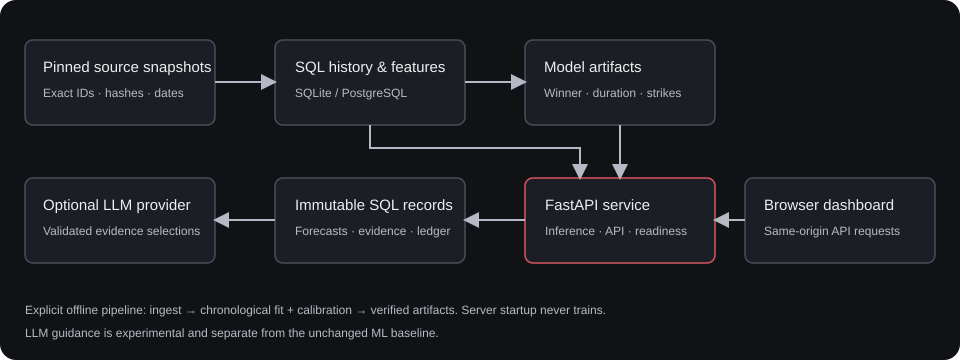

# Architecture

OctogonML runs as one Python service: FastAPI serves the buildless HTML/CSS/JavaScript dashboard and a versioned REST API. SQLite supports a local checkout; SQLAlchemy and Alembic also support PostgreSQL. No separate frontend server, queue, or model-serving cluster is required.

## Data and model boundaries

1. Explicit ingestion validates exact fighter/bout identities and pinned source bytes, then imports canonical history into SQL.
2. Features use observations strictly before their cutoff. Chronological fitting and reserved calibration produce separately versioned winner, duration, and strike artifacts.
3. Startup verifies trusted packaged artifacts and prepares historical states. It does not train or refresh sources.
4. API inference records feature values, model identity, source snapshot, cutoffs, and forecast output. Saved records remain immutable.
5. Optional analysis accepts matching saved forecast IDs. Server-authored facts and validated LLM selections produce a separately stored report and experimental overlay.

Winner **V2**, strike **V3**, and the independent duration classifier are the retained defaults. Failed winner V3/V4 studies remain explicit research channels. Comparison-only statistics and current ranking observations do not silently become model inputs. See [model evidence](model-evidence.md) and the [detailed design](ENGINEERING.md).

## Main modules

| Area | Location | Responsibility |
| --- | --- | --- |
| HTTP boundary | `src/cagemetrics/api.py`, `http_runtime.py` | REST contracts, request IDs, request limits, logs, metrics |
| Persistence | `src/cagemetrics/db.py`, `migrations/` | SQL lineage, migrations, immutable forecasts and analyses |
| CLI and configuration | `cli.py`, `config.py` | Explicit pipeline/operations commands and path selection |
| Model engines | `serving.py`, `modeling.py`, `winner*.py`, `rounds.py` | Independent inference, training, calibration, verification |
| Evidence and narration | `analysis*.py`, `matchup_brief.py`, `reliability.py` | Frozen facts, source references, grounded selections, coverage policy |
| Dashboard | `src/cagemetrics/web/` | Same-origin UI, real photos with fallback, separate model displays |
| Retained evidence | `data/`, `artifacts/`, `reports/` | Source manifests, normalized observations, models, historical reports |

## HTTP and operational boundary

`/health/live` describes process liveness; `/health/ready` requires the core strike model, SQL, and matching source state. Winner and duration models are reported separately and can be unavailable while core strike inference stays ready. The API adds a UUID `X-Request-ID`, emits structured request logs using route templates, and exposes bounded per-process Prometheus counters and latency histograms at `/metrics`.

The request-body limit is checked before handlers, including streamed bodies. Unexpected failures before headers return safe JSON with status 500 and a request ID. If headers were already sent, the stream terminates with a sanitized error and increments an aborted-response counter; its original HTTP status cannot be replaced. Operators own access control, TLS, proxy timeouts, backups, and monitoring. [Operations](operations.md) describes configuration and recovery.

The optional narrator can fail independently of ordinary forecasts. Both local and hosted provider paths validate output; failures are explicit errors, not fabricated fallback analyses. No network source refresh or training happens during an ordinary forecast request.

## Historical scope

As of this November 12, 2026 documentation review, the packaged history ends October 17, 2026. The October 22 announcements, media observations, projections, and screenshots are retained snapshots. Fresh operational monitoring does not make those sporting observations current.

For the full rationale, temporal rules, artifact fingerprints, and uncertainty limitations, use [ENGINEERING.md](ENGINEERING.md), [MODEL_CARD.md](../MODEL_CARD.md), and [WINNER_RESEARCH.md](WINNER_RESEARCH.md).
